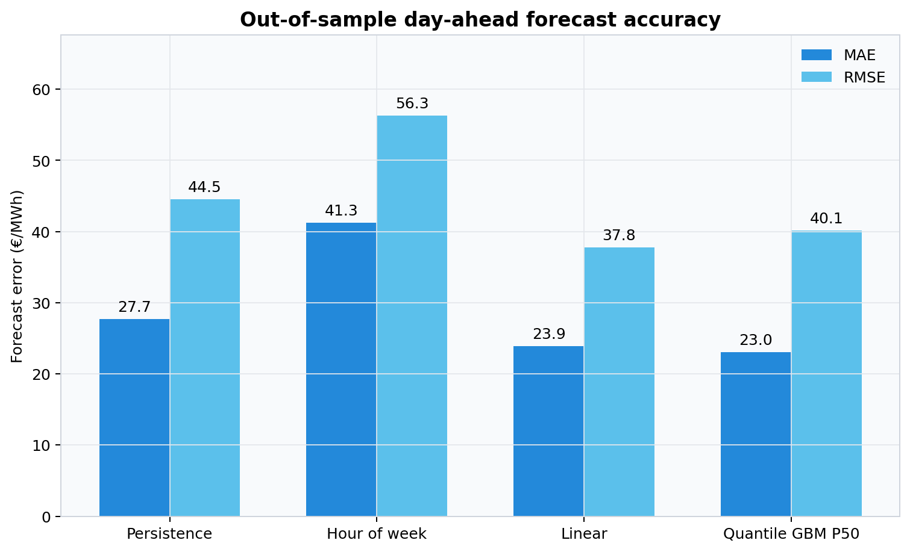
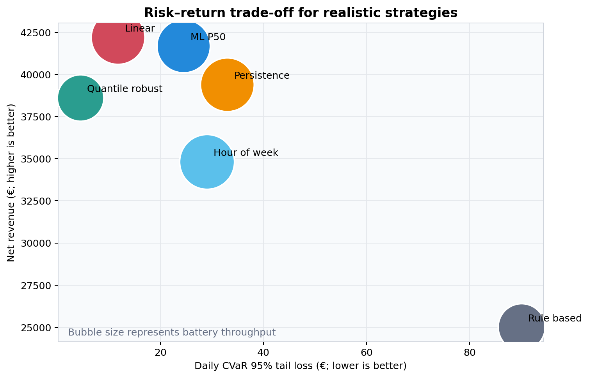
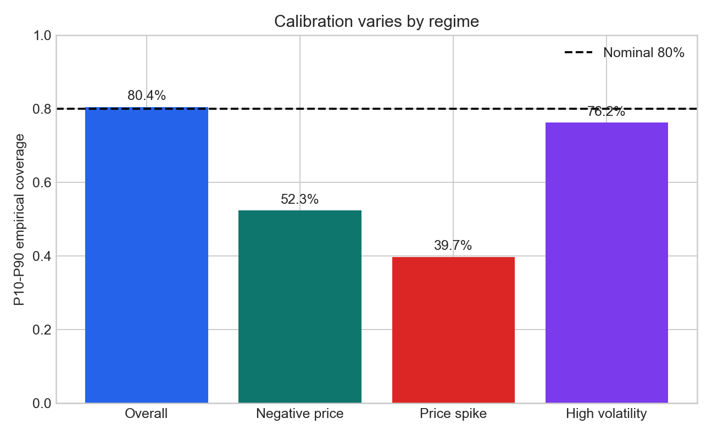
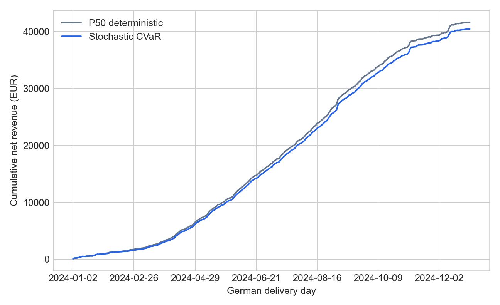

# German Multi-Market BESS Trading & Risk Engine

A reproducible applied research repository for studying how day-ahead price forecast
quality and uncertainty affect a simulated German battery's dispatch, revenue, and
risk. It combines real ENTSO-E prices, rolling probabilistic forecasting, constrained
optimization, realized-price settlement, and an interactive dashboard. It does not
claim live trading performance or fabricate balancing-market data.

> **Phase 1 correctness upgrade:** the current pipeline uses causal daily forecast
> snapshots, German delivery days, interval-aware mixed-integer dispatch, continuous
> SOC, daily P&L risk, paired bootstrap confidence intervals, and eight baselines. The
> earlier November pilot remains available for comparison; corrected full-year results
> are generated in `results/phase1_2024`.


## Problem and research questions

Battery value depends less on predicting every price precisely than on identifying the
right spreads under physical constraints. This project asks whether lower MAE actually
means higher revenue, which mistakes are economically costly, whether calibrated
quantiles improve risk-adjusted returns, how large realistic regret is, and how results
change with duration, efficiency, and degradation assumptions.

## German market context

The German/Luxembourg day-ahead market clears delivery intervals ahead of operation;
high variable renewable output can compress or invert prices, while scarcity and
forecast errors create volatile spreads. A battery can shift energy but loses energy
and incurs wear. Reserve participation can add value but has different availability,
activation, and settlement rules, so it cannot be inferred from day-ahead prices.

## Data

The credential-safe ENTSO-E client downloads day-ahead prices, actual load, and
generation. Raw and processed stores are separate and ignored by Git. Validation checks
UTC, duplicates, gaps, irregular frequency, schema, infinities, and impossible physical
values. See [DATA_DICTIONARY.md](DATA_DICTIONARY.md). ENTSO-E access requires a free
Transparency Platform API token.

```powershell
Copy-Item .env.example .env
# Load ENTSOE_API_TOKEN into your shell using your preferred secret manager.
python -m pip install -e ".[dev,dashboard,models]"
bess-research fetch-prices --start 2024-01-01 --end 2025-01-01
# Or acquire a 3–5 year research history in API-safe annual chunks:
bess-research fetch-history --start 2020-01-01 --end 2025-01-01
# Archived forecast-time fundamentals for Phase 2:
bess-research fetch-fundamentals --start 2023-01-01 --end 2025-01-01
```

The CLI reads `ENTSOE_API_TOKEN` from the environment; it does not automatically parse
`.env`, reducing accidental secret persistence. API errors never log the request URL.

## Forecasting methodology

Baselines are previous-day persistence and expanding historical hour-of-week means. A
portable quantile gradient-boosting model produces P10/P50/P90; optional LightGBM and
XGBoost dependencies are reserved for experiment adapters. Evaluation uses rolling
temporal windows only. Price lags and rolling values are conservative and fundamentals
must be archived day-ahead forecasts. See [ASSUMPTIONS.md](ASSUMPTIONS.md).

The published benchmark refits the quantile GBM every seven days using a trailing
365-day window. The model uses local calendar encodings, 24/48/168-hour price lags,
and causal rolling price statistics. It does not use realized load, renewable
generation, or any future price.



The P50 gradient-boosting model improves both MAE and RMSE over the simple baselines,
but forecast accuracy alone does not determine battery revenue.

## Battery model and optimization

The default simulated battery is 1 MW / 2 MWh with 10–90% SOC, 95% one-way efficiency,
a linear degradation cost, and a daily equivalent-cycle constraint. CVXPY maximizes
forecast margin net of degradation while enforcing energy, power, SOC, cycle, and
terminal-SOC constraints. The robust policy penalizes charging with upper-tail prices
and discharging with lower-tail prices. Perfect foresight uses the same optimizer and
is only an unattainable upper bound.

Phase 1 explicitly includes the market time unit in SOC, settlement, throughput, and
degradation equations. A binary operating mode prevents simultaneous charge/discharge,
SOC carries across 23/24/25-hour German delivery days, and a configurable terminal
energy value replaces forced daily SOC resets.

Phase 2 adds a non-anticipative stochastic mixed-integer program. It maximizes expected
scenario revenue minus an explicit CVaR loss penalty; all scenarios share one physical
schedule. Circular residual blocks retain multi-hour dependence, and diagnostics compare
lag-one correlation and tail frequency against observations. Split-conformal calibration,
WIS, empirical CRPS, PIT, regime coverage, efficient frontiers, degradation sensitivities,
and paired block-bootstrap effect sizes are implemented in the configured research pipeline.
See [the Phase 2 protocol](docs/PHASE2_IMPLEMENTATION.md).

## Published benchmark results

The corrected Phase 1 benchmark uses five years of ENTSO-E prices (2020–2024) and
covers **327 complete German delivery days** in the 2024 out-of-sample replay. Models
use daily causal snapshots and weekly refits; schedules are settled against realized
prices. Values below simulate the default 1 MW / 2 MWh battery with €5/MWh throughput
degradation. Fifty-one test-year source intervals are not imputed for
settlement, and affected delivery days are excluded and reported in `metrics.json`.

| Forecast | MAE (€/MWh) | RMSE (€/MWh) |
|---|---:|---:|
| Persistence | 27.71 | 44.50 |
| Historical hour-of-week | 30.88 | 47.73 |
| Regularized linear | 23.91 | **37.78** |
| Quantile GBM P50 | **22.75** | 39.59 |

The P10–P90 interval covered 70.8% of prices with a mean width of €56.66/MWh. This is a
material improvement over the legacy pilot but remains below the nominal 80% target;
the quantiles are therefore still labelled under-calibrated.


The highest-spread test day illustrates an economically important failure mode: the
model recognized an afternoon price increase, but materially underestimated its size
and the realized price moved outside P90.

| Strategy | Net revenue (€) | Throughput (MWh) | Daily CVaR loss (€) | Regret (€) |
|---|---:|---:|---:|---:|
| Perfect foresight upper bound | 50,399 | 1,623.1 | 0.1 | 0 |
| Regularized linear | **42,207** | 1,641.3 | 11.8 | 8,192 |
| ML P50 | 41,661 | 1,632.7 | 23.3 | 8,738 |
| Persistence | 39,404 | 1,647.1 | 33.0 | 10,995 |
| Quantile robust | 38,686 | **1,223.8** | **4.5** | 11,713 |
| Hour of week | 36,542 | 1,715.5 | 37.9 | 13,857 |
| Rule based | 25,074 | 1,249.9 | 92.9 | 25,325 |
| Zero trade | 0 | 0 | 0 | 50,399 |

The corrected result is more nuanced than the pilot. P50 has the lowest MAE, but the
linear model earns €546 more; its paired seven-day block-bootstrap interval versus P50
includes zero, so that revenue difference is not statistically established. The
quantile-robust policy sacrifices €2,975 versus P50 while reducing throughput by 25.1%
and daily CVaR loss from €23.27 to €4.46. This supports a risk–return trade-off, not a
claim that probabilistic dispatch dominates on revenue.



The robust policy occupies the low-risk region but not the highest-return region.
Bubble size represents throughput, making its lower battery use visible.


### Battery operation

The optimizer respects grid-side power, SOC, efficiency, cycling, binary operating
mode, and continuous interday SOC. The representative day shows how forecast
uncertainty translates into charge/discharge decisions.


Machine-readable forecasts, dispatch, metrics, input hashes, and a full discussion are
in [`results/phase1_2024`](results/phase1_2024). The legacy pilot remains in
[`results/energy_benchmark_2024`](results/energy_benchmark_2024). The experiment
design and future regime analyses are specified in
[docs/EXPERIMENT_DESIGN.md](docs/EXPERIMENT_DESIGN.md).

## Phase 2 probabilistic-value result

The leakage-safe Phase 2 replay uses July–December 2023 for calibration and scenario
residuals, then evaluates 326 complete German delivery days in 2024. Split conformalization
adds EUR 6.30/MWh to each interval bound and raises overall P10–P90 coverage to **80.43%**,
close to the nominal 80% target. WIS is 15.28, empirical CRPS is 17.01, and mean PIT is 0.480.

Calibration is not uniform: coverage falls to 52.3% during negative prices, 39.7% for price
spikes, and 76.2% in high-volatility intervals. Scenario validation is materially stronger:
lag-one correlation differs from observations by 0.038 and tail-event frequency by 2.53
percentage points.



The central research result is negative. At lambda=0.20 and 95% CVaR, stochastic dispatch
earned **EUR 3.66 less per day** than deterministic P50. The paired seven-day block-bootstrap
95% interval is EUR -5.52 to EUR -1.60 per day; paired effect size is -0.21 and bootstrap
probability of improvement is 0%. Probabilistic forecasting improved uncertainty calibration,
but did not improve battery revenue under this policy and test period.



The representative-day frontier makes the trade-off explicit: increasing risk aversion lowers
scenario CVaR loss while also reducing expected revenue. The published sensitivity table varies
duration, one-way efficiency, degradation cost and cycle limit on the same scenario set.


All artifacts, including scenarios, error attribution, regime labels, paired inference,
frontier and sensitivities, are in [`results/phase2_2024`](results/phase2_2024).

## Limitations

This is a historical simulation of a price-taking battery, not commercial trading. It
omits bid acceptance, fees, imbalance, network charges, taxes, intraday updates, and
detailed cell aging. Multi-market logic is intentionally pending real
regelleistung.net capacity and activation data plus product rules. Actual load and
generation are not valid forecast-time features.

## Architecture

Source code lives in `src/bess_trading`; configuration, tests, documentation, dashboard,
and immutable/processed data layers are separate. The full dataflow and artifact
contract are in [docs/ARCHITECTURE.md](docs/ARCHITECTURE.md).
The requirement-by-requirement acceptance record is in
[docs/PHASE1_IMPLEMENTATION.md](docs/PHASE1_IMPLEMENTATION.md).

## Reproduce

```bash
python -m pip install -e ".[dev,dashboard,visualization]"
pytest
ruff check .
bess-research run-phase1 --config configs/phase1.yaml
bess-research run-phase2 --config configs/phase2.yaml
python experiments/create_readme_figures.py
streamlit run dashboard/app.py
```

Docker builds the dashboard without embedding credentials. Mount data read-only or use
the CLI outside the container to create experiment artifacts.

Phase 1 CI currently enforces at least 75% package coverage; the implemented suite is
at approximately 79% and includes a synthetic end-to-end pipeline replay.

## Future work

Real reserve-market co-optimization, intraday recourse, market-rule-aware bids, and
cell-chemistry-specific aging remain future work. Phase 2 results are published only after the
untouched test run finishes; implemented methods are not presented as empirical findings.
