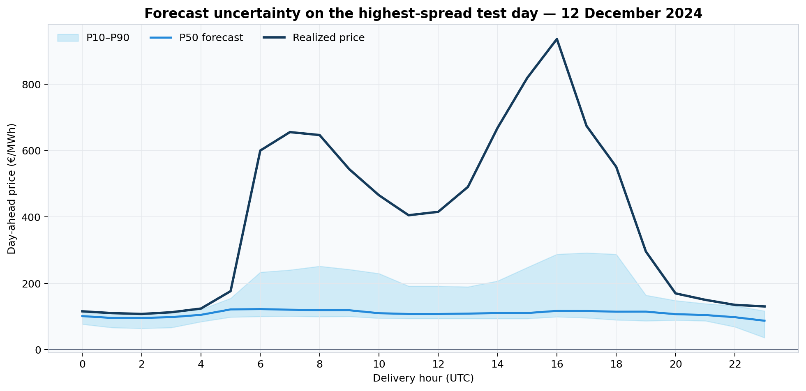
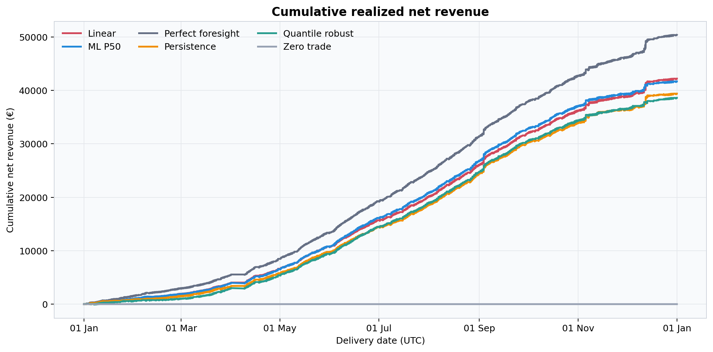
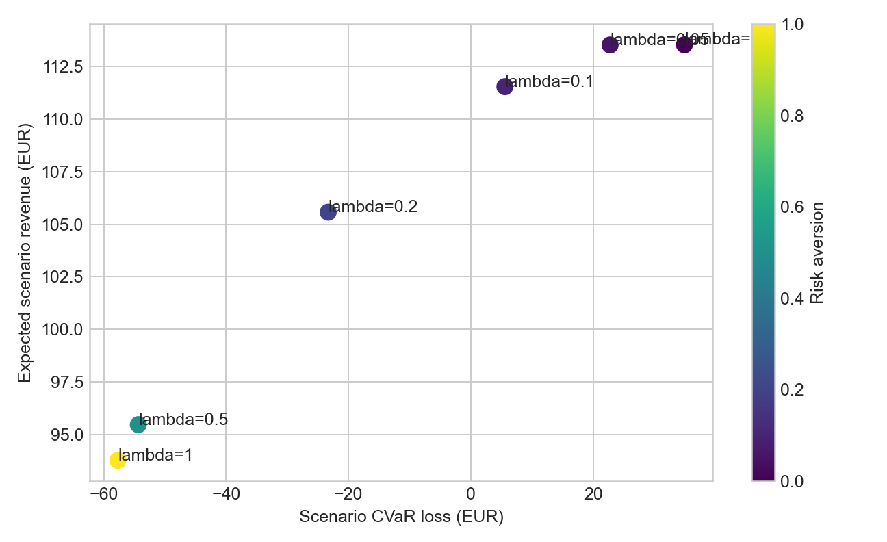

# German Multi-Market Battery Trading and Risk Engine

[](https://www.python.org/)
[](https://github.com/MhdAsker/Battery-Trading-Risk-Engine-German-Electricity-Markets/releases/tag/v0.3.0)


A reproducible research platform for studying how electricity-price forecasts, uncertainty,
battery physics and German market rules interact to determine battery energy storage system
(BESS) value.

The repository combines real ENTSO-E day-ahead data, causal rolling forecasts, probabilistic
calibration, mixed-integer dispatch, stochastic CVaR optimization, daily P&L inference and a
present-day 15-minute multi-market engine for day-ahead, intraday, FCR, aFRR and mFRR.

The evidence boundary is explicit: Phase 1 and Phase 2 report measured historical results.
Phase 3 implements commercial-style decision, audit and settlement machinery, but does not
publish reserve revenue without authoritative asset-level award and activation records. Public
clearing prices alone are not treated as proof that a battery earned money.


## Contents

- [Abstract](#abstract)
- [Research contributions](#research-contributions)
- [Research questions and findings](#research-questions-and-findings)
- [German market design](#german-market-design)
- [Data and provenance](#data-and-provenance)
- [Causal forecasting](#causal-forecasting)
- [Battery and optimization models](#battery-and-optimization-models)
- [Experimental design](#experimental-design)
- [Phase 1 results](#phase-1-results-causal-energy-only-benchmark)
- [Phase 2 results](#phase-2-results-probabilistic-forecast-value)
- [Phase 3 engine](#phase-3-present-day-multi-market-engine)
- [Architecture and artifacts](#architecture-and-artifacts)
- [Reproduction](#reproduction)
- [Testing](#testing-and-quality-controls)
- [Limitations](#limitations)
- [Citation](#citation)

## Abstract

Electricity-price forecasting studies often optimize statistical accuracy while battery trading
studies frequently assume perfect foresight, ignore forecast issue times, reset state of charge
each day or infer reserve revenue from public clearing prices. Those choices can produce
optimistic and operationally invalid results.

This project evaluates a stricter question: under information genuinely available at decision
time, how much value can a physically constrained battery capture, how uncertain is that value,
and does a probabilistic forecast improve the realized revenue-risk trade-off?

The empirical study uses five years of German/Luxembourg ENTSO-E day-ahead prices. Forecasts
are generated as daily causal snapshots, models are refitted on rolling historical windows and
the final year is reserved for out-of-sample evaluation. Dispatch respects power, energy,
efficiency, degradation, equivalent-cycle, shared-inverter and binary operating-mode
constraints. State of charge remains continuous across German delivery days, including
daylight-saving transitions.

Phase 1 shows that forecast accuracy and trading revenue are related but not equivalent: the
quantile GBM has the lowest MAE, while regularized linear regression earns slightly more, with
an economically small and statistically uncertain difference. Phase 2 conformalizes the
predictive interval to 80.43% overall coverage and constructs temporally coherent price
scenarios. Nevertheless, stochastic CVaR dispatch earns EUR 3.66 less per day than deterministic
P50, with a paired 95% block-bootstrap interval of EUR -5.52 to EUR -1.60. This negative result
is central: improved uncertainty calibration did not translate into higher battery revenue under
the tested policy and market year.

Phase 3 generalizes the software into an audited 15-minute multi-market engine. It supports
energy recourse, symmetric and asymmetric reserve, product blocks, gate closures, activation
stress, outages, fees, imbalance settlement and exact value reconciliation. Its strict
provenance contract prevents simulated reserve awards from being presented as realized income.

## Research contributions

1. **Causal forecast construction.** Every feature has an availability timestamp that must
   precede the forecast issue time. Realized load, generation and future prices are excluded.
2. **Calendar-correct German delivery days.** Europe/Berlin days can contain 23, 24 or 25
   hours. SOC and settlement operate on the actual UTC delivery intervals.
3. **Interval-aware accounting.** The same energy equations work for 15-, 30- and 60-minute
   market time units.
4. **Strict physical feasibility.** Binary operating mode and a shared inverter prevent
   simultaneous charging and discharging, including under extreme negative prices.
5. **Forecast-to-value evaluation.** Forecast scores, realized revenue, downside risk,
   degradation and perfect-foresight regret are evaluated together.
6. **Calibrated probabilistic forecasting.** Split conformal calibration, WIS, empirical CRPS,
   PIT and conditional coverage are implemented without test-period tuning.
7. **Coherent scenarios and explicit CVaR.** Residual blocks preserve multi-hour dependence;
   all scenarios share one non-anticipative schedule.
8. **Paired economic inference.** Revenue comparisons use circular block-bootstrap confidence
   intervals, paired effect sizes and probability of improvement.
9. **Present-day multi-market representation.** The engine supports 15-minute energy,
   four-hour reserve products, FCR, aFRR, mFRR, recourse and activation deliverability.
10. **Reconstructable decisions.** Inputs, hashes, configuration, issue time, model version,
    solver output and action can be stored in an append-only experiment registry.
11. **Evidence discipline.** Synthetic data is restricted to tests. Published market revenue
    must map to authoritative observations and carry source provenance.

## Research questions and findings

| Research question | Evidence-based answer |
|---|---|
| Does lower price MAE guarantee higher battery revenue? | No. P50 has lower MAE than the linear model, while the linear model earns EUR 513.64 more. Its paired confidence interval includes zero. |
| Do raw P10-P90 quantiles achieve nominal coverage? | No. Phase 1 coverage is 70.75%, below the nominal 80%. |
| Can conformal calibration repair unconditional coverage? | Yes. Phase 2 coverage reaches 80.43% using only pre-test calibration data. |
| Is calibration stable across market regimes? | No. Coverage falls to 52.34% for negative prices and 39.72% for price spikes. |
| Does the tested stochastic CVaR policy improve revenue? | No. It loses EUR 3.66/day versus P50; the paired 95% interval is entirely below zero. |
| Does risk aversion reduce downside exposure? | Yes, at an opportunity cost. Robust dispatch reduces throughput and CVaR loss while earning less. |
| Can reserve value be inferred from public capacity prices? | No. Asset awards and delivered activation are required before revenue is recognized. |
| Is Phase 3 a live autonomous trader? | No. It is a research and replay engine requiring BSP integration, telemetry and governance for deployment. |

## German market design

The empirical Phase 1/2 benchmark studies the Germany/Luxembourg day-ahead bidding zone.
Renewable surplus can create low or negative prices, while scarcity and forecast errors create
sharp positive spikes. A battery monetizes temporal spreads but loses energy, consumes cycle
life and must preserve power and SOC for committed reserve.

Phase 3 rules were checked on 13 November 2026 against the official
[Regelleistung tendering page](https://www.regelleistung.net/en-us/Become-a-balancing-service-provider/Tendering-and-bidding-process).
They are versioned inputs because market design changes over time.

| Product | Direction | Length | Gate closure | Minimum | Increment | Remuneration |
|---|---|---:|---|---:|---:|---|
| FCR capacity | Symmetric | 4 hours | D-1 08:00 Europe/Berlin | 1 MW | 1 MW | Pay-as-cleared |
| aFRR capacity | Positive/negative | 4 hours | D-1 09:00 | 1 MW | 1 MW | Pay-as-bid |
| mFRR capacity | Positive/negative | 4 hours | D-1 10:00 | 1 MW | 1 MW | Pay-as-bid |
| aFRR energy | Positive/negative | 15 minutes | T-25 minutes | 1 MW | 1 MW | Pay-as-cleared |
| mFRR energy | Positive/negative | 15 minutes | T-25 minutes | 1 MW | 1 MW | Pay-as-cleared |

ENTSO-E reports that Single Day-Ahead Coupling moved to a 15-minute market time unit for
delivery from 1 October 2025. The software retains the resolution applicable to each historical
period rather than pretending older hourly products were quarter-hourly.

## Data and provenance

### ENTSO-E research data

The credential-safe client supports:

- Germany/Luxembourg day-ahead prices;
- archived day-ahead total-load forecasts;
- archived day-ahead wind and solar forecasts;
- actual load and generation by production type;
- 15-, 30- and 60-minute ENTSO-E XML periods;
- annual chunks for multi-year histories.

Raw stores are ignored by Git. Committed experiment artifacts contain input hashes, effective
configuration and results. Validation checks timezones, duplicates, gaps, frequency, infinities
and impossible values. Settlement outcomes are never filled. Incomplete delivery days are
excluded and reported. Causal filling is permitted only for feature construction and uses past
information with a strict maximum gap.

### Reserve-market provenance

The official [Regelleistung data guide](https://www.regelleistung.net/en-us/Data/Where-can-I-find-what-data)
states that offer and auction information is distributed through the Data Center, while
activation publications are available through Netztransparenz; authenticated CSV/SFTP access
is also available. There is no unrestricted public API for the complete workflow.

The importer records source name, source URL, UTC download time, file SHA-256 and unique UTC
timestamps. Reserve settlement additionally requires separate provenance for:

1. asset capacity awards;
2. asset-delivered activation;
3. activation settlement prices.

If any are absent, settlement fails closed. System-wide activation and public clearing prices
cannot be misrepresented as asset revenue. See [DATA_DICTIONARY.md](DATA_DICTIONARY.md) and
[ASSUMPTIONS.md](ASSUMPTIONS.md).

## Causal forecasting

Forecasts are issued once per German delivery day at a configured local issue hour. Every
feature snapshot is audited against that issue time. Models may be refitted weekly, but each
prediction remains causal.

Price features include previous local-day price by hour, 48-hour and seven-day lags, causal
24-hour and 168-hour rolling statistics, calendar encodings and circular hour encodings.

With archived fundamentals, the model adds:

\[
RenewablesForecast_t=WindForecast_t+SolarForecast_t,
\]

\[
ResidualLoadForecast_t=LoadForecast_t-RenewablesForecast_t,
\]

\[
RenewableShareForecast_t=\frac{RenewablesForecast_t}{LoadForecast_t}.
\]

Only columns explicitly named `*_forecast_mw` are admitted as forecast-time fundamentals.

Models and baselines include zero trade, rule-based dispatch, previous-day persistence,
historical hour of week, standardized Ridge regression, quantile gradient boosting and optional
LightGBM/XGBoost adapters. Perfect foresight uses the same physical optimizer and is reported
only as an unattainable upper bound.

Nested validation uses trailing temporal windows. The final test period influences neither
model selection nor conformal calibration. Phase 2 reports pinball loss, interval coverage,
width, WIS, CRPS, PIT, regime coverage and scenario correlation/tail diagnostics.

## Battery and optimization models

### Default asset

| Parameter | Default |
|---|---:|
| Power | 1 MW |
| Energy | 2 MWh |
| SOC range | 10%-90% |
| Initial SOC | 50% |
| Charge/discharge efficiency | 95% / 95% |
| Throughput degradation | EUR 5/MWh |
| Daily equivalent-cycle limit | 1.5 |

For interval duration \(\Delta t\):

\[
SOC_{t+1}=SOC_t+\Delta t\left(\eta_cP^c_t-\frac{P^d_t}{\eta_d}\right).
\]

Binary operating mode and shared-inverter constraints are:

\[
0\le P^c_t\le P_{max}z_t,\quad
0\le P^d_t\le P_{max}(1-z_t),\quad z_t\in\{0,1\},
\]

\[
P^c_t+P^d_t\le P_{max}.
\]

SOC persists continuously between delivery days. A terminal energy value replaces forced daily
resets. Degradation studies include linear throughput, piecewise throughput and a rainflow-style
equivalent-cycle proxy.

### Stochastic CVaR

Residual blocks preserve multi-hour price dependence. One schedule is shared across scenarios:

\[
\max_x\sum_sp_sR_s(x)-\lambda\left[\zeta+
\frac{1}{1-\alpha}\sum_sp_su_s\right],
\]

\[
u_s\ge L_s(x)-\zeta,\qquad u_s\ge0.
\]

The pipeline produces efficient frontiers and duration, efficiency, cycle-limit, degradation and
risk-aversion sensitivities.

### Multi-market co-optimization

Phase 3 represents day-ahead energy, intraday recourse, symmetric FCR, positive/negative aFRR,
positive/negative mFRR, activation uncertainty, transaction fees, imbalance, penalties, outages
and derating.

With total upward and downward reserve \(R_t^+\) and \(R_t^-\):

\[
P^d_t+R_t^+\le P^{available}_t,\qquad
P^c_t+R_t^-\le P^{available}_t.
\]

For sustained activation duration \(\tau\), SOC deliverability requires:

\[
SOC_t-SOC_{min}\ge\tau\frac{R_t^+}{\eta_d},\qquad
SOC_{max}-SOC_t\ge\tau\eta_cR_t^-.
\]

Capacity decisions are coupled across local four-hour blocks. Binary variables enforce
zero-or-at-least-1-MW reserve bids. Rolling-horizon MPC re-solves at every quarter hour and
executes only the first action.

## Experimental design

| Design choice | Phase 1 | Phase 2 |
|---|---|---|
| Historical source | ENTSO-E 2020-2024 | Same causal forecast system |
| Calibration period | Not applicable | July-December 2023 |
| Untouched test | Calendar 2024 | Calendar 2024 |
| Complete delivery days | 327 | 326 |
| Training window | Trailing 365 days | Trailing 365 days |
| Model refit | Every 7 days | Every 7 days |
| Scenarios | None | 100 residual-block paths |
| Inference | Paired block bootstrap | Paired block bootstrap/effect size |

Phase 3 is a validated engine rather than a published revenue backtest. A stacked-market study
is admitted only when identical assets and dates have authoritative energy trades, capacity
awards, delivered activation, imbalance, fees and penalties.

## Phase 1 results: causal energy-only benchmark

### Forecast accuracy

| Forecast | MAE (EUR/MWh) | RMSE (EUR/MWh) |
|---|---:|---:|
| Persistence | 27.71 | 44.50 |
| Historical hour of week | 41.26 | 56.33 |
| Regularized linear | 23.91 | **37.79** |
| Quantile GBM P50 | **23.02** | 40.11 |

Raw P10-P90 coverage is 70.75% with a mean width of EUR 56.72/MWh, below the nominal 80%.




### Trading performance

| Strategy | Net revenue (EUR) | Throughput (MWh) | Daily CVaR loss (EUR) | Regret (EUR) |
|---|---:|---:|---:|---:|
| Perfect foresight | 50,399.09 | 1,623.09 | 0.12 | 0.00 |
| Regularized linear | **42,207.89** | 1,641.15 | 11.79 | 8,191.19 |
| ML P50 | 41,694.25 | 1,623.20 | 24.48 | 8,704.83 |
| Persistence | 39,403.71 | 1,647.15 | 32.98 | 10,995.37 |
| Quantile robust | 38,617.27 | **1,223.22** | **4.46** | 11,781.81 |
| Historical hour of week | 34,830.82 | 1,715.54 | 29.01 | 15,568.27 |
| Rule based | 25,009.82 | 1,246.74 | 90.01 | 25,389.27 |
| Zero trade | 0.00 | 0.00 | 0.00 | 50,399.09 |

The linear strategy earns EUR 513.64 more than ML P50 despite P50's lower MAE. The paired
bootstrap interval includes zero, so the advantage is not statistically established.

Quantile-robust dispatch sacrifices EUR 3,076.98 relative to ML P50 while reducing throughput
by approximately 24.6% and daily CVaR loss from EUR 24.48 to EUR 4.46. It occupies a lower-risk,
lower-return region rather than dominating deterministic dispatch.





Machine-readable evidence is in [`results/phase1_2024`](results/phase1_2024).

## Phase 2 results: probabilistic forecast value

Split conformal calibration adds EUR 6.30/MWh to each raw interval bound and raises overall
P10-P90 coverage to 80.43%.

| Metric | Result |
|---|---:|
| P10-P90 coverage | 80.43% |
| WIS | 15.28 |
| Empirical CRPS | 17.01 |
| Mean PIT | 0.480 |
| Scenario lag-one correlation error | 0.038 |
| Scenario tail-frequency error | 2.53 percentage points |

Overall calibration masks conditional failure:

| Regime | Intervals | Coverage | Width (EUR/MWh) |
|---|---:|---:|---:|
| Negative price | 428 | 52.34% | 90.16 |
| Price spike | 428 | 39.72% | 94.97 |
| High volatility | 2,138 | 76.19% | 75.17 |


At \(\lambda=0.20\) and 95% CVaR, stochastic dispatch earns EUR 3.66 less per day than P50.

| Paired inference | Result |
|---|---:|
| Mean daily difference | EUR -3.66 |
| 95% CI | EUR -5.52 to EUR -1.60 |
| Paired effect size | -0.212 |
| Bootstrap probability of improvement | 0% |

The answer is negative: calibration improves probabilistic reliability, but the tested
stochastic CVaR policy does not improve realized 2024 battery revenue. This does not imply that
probabilistic forecasts have no value elsewhere; it demonstrates that value must be measured,
not inferred from coverage alone.




Scenarios, attribution, regimes, P&L, frontier and sensitivities are in
[`results/phase2_2024`](results/phase2_2024).

## Phase 3: present-day multi-market engine

Release [`v0.3.0`](https://github.com/MhdAsker/Battery-Trading-Risk-Engine-German-Electricity-Markets/releases/tag/v0.3.0)
implements:

- native 15-minute energy decisions and intraday recourse;
- rolling-horizon model-predictive control;
- FCR, aFRR and mFRR capacity decisions;
- symmetric/asymmetric reserve requirements;
- four-hour blocks and quarter-hour energy products;
- gate closures and minimum-bid constraints;
- reserve headroom and SOC deliverability;
- joint activation-volume/price scenarios;
- availability, outages and derating;
- fees, imbalance and availability penalties;
- exact settlement reconciliation;
- EVPI, VSS, regret and marginal asset values;
- solver diagnostics and reconstructable decision trails.

The value identity is:

\[
V=V_{DA}+V_{ID}+V_{capacity}+V_{activation}+V_{imbalance}
-V_{fees}-V_{penalties}-V_{degradation}.
\]

Every interval component is stored separately and the aggregate is asserted to equal their sum.
Energy-only and stacked comparisons must use identical asset parameters and delivery dates.

### Decision reconstruction

The SQLite registry stores experiment UUID, Git commit, canonical configuration and hash, model
versions, issue time, delivery time, market, solver status, objective, input hashes, action and
an immutable audit hash. A decision can be retrieved and reconstructed by that hash.

See the [paper-style Phase 3 report](docs/PHASE3_REPORT.md).

## Architecture and artifacts

```text
battery_trading/
|-- configs/                     Reproducible experiment configurations
|-- dashboard/                   Streamlit research dashboard
|-- data/raw/                    Immutable downloads, ignored by Git
|-- data/processed/              Validated tables, ignored by Git
|-- docs/                        Architecture and research reports
|-- experiments/                 Experiment and figure entry points
|-- results/phase1_2024/         Causal energy-only evidence
|-- results/phase2_2024/         Probabilistic-value evidence
|-- src/bess_trading/
|   |-- audit/                   Registry and decision reconstruction
|   |-- backtesting/             Realized settlement
|   |-- battery/                 Physical/degradation models
|   |-- data/                    ENTSO-E/Regelleistung adapters
|   |-- experiments/             Audited pipelines
|   |-- features/                Leakage-safe features
|   |-- forecasting/             Models, calibration, scenarios
|   |-- markets/                 Versioned product rules
|   |-- metrics/                 Scores, risk and inference
|   |-- optimization/            Deterministic/stochastic/multi-market models
|   `-- settlement/              Value reconciliation
`-- tests/                       Physical, temporal, statistical and audit tests
```

Documentation:

- [Architecture](docs/ARCHITECTURE.md)
- [Experiment design](docs/EXPERIMENT_DESIGN.md)
- [Phase 1 implementation](docs/PHASE1_IMPLEMENTATION.md)
- [Phase 2 methodology](docs/PHASE2_IMPLEMENTATION.md)
- [Phase 3 report](docs/PHASE3_REPORT.md)
- [Data dictionary](DATA_DICTIONARY.md)
- [Assumptions](ASSUMPTIONS.md)

## Reproduction

### Install

```powershell
git clone https://github.com/MhdAsker/Battery-Trading-Risk-Engine-German-Electricity-Markets.git
Set-Location Battery-Trading-Risk-Engine-German-Electricity-Markets
python -m venv .venv
.venv\Scripts\Activate.ps1
python -m pip install --upgrade pip
python -m pip install -e ".[dev,dashboard,visualization,models]"
```

LightGBM/XGBoost are optional. The portable quantile model uses core dependencies.

### Configure ENTSO-E securely

```powershell
$env:ENTSOE_API_TOKEN = "retrieve-from-your-secret-manager"
```

The token is read from the environment, excluded from logs and never written to artifacts.

### Acquire research data

```powershell
bess-research fetch-history --start 2020-01-01 --end 2025-01-01
bess-research fetch-fundamentals --start 2023-01-01 --end 2025-01-01
```

### Run experiments

```powershell
bess-research run-phase1 --config configs/phase1.yaml
bess-research run-phase2 --config configs/phase2.yaml
```

Phase 3 uses [`configs/phase3.example.yaml`](configs/phase3.example.yaml) as its data contract
and requires authoritative asset settlement records.

### Recreate figures and dashboard

```powershell
python experiments/create_readme_figures.py
python experiments/create_phase2_figures.py
streamlit run dashboard/app.py
```

### Validate

```powershell
ruff check .
pytest
pytest --cov=src/bess_trading --cov-report=term-missing
```

Docker builds the dashboard without embedding credentials. Generate artifacts externally or
mount them read-only.

## Testing and quality controls

The repository has 43 passing tests and approximately 81% package coverage. Tests include:

- interval-aware SOC at 15, 30 and 60 minutes;
- spring and autumn DST days;
- no simultaneous cycling under negative prices;
- causal feature invariance and publication-time audits;
- daily risk and paired bootstrap inference;
- conformal calibration, WIS, CRPS and PIT;
- coherent scenario reproducibility;
- stochastic CVaR feasibility;
- four-hour reserve block coupling and minimum bids;
- reserve power/SOC stress tests;
- outage derating and MPC execution;
- source provenance and input hashes;
- exact settlement reconciliation;
- decision audit reconstruction;
- synthetic end-to-end replays.

Synthetic fixtures validate constraints only and are never reported as market performance.

## Limitations

### Energy-only evidence

- Historical price-taking simulation, not executable bid replay.
- No market impact, taxes or network tariffs.
- Phase 1/2 use hourly products because that was the source resolution for the test year.
- Negative-price and scarcity-spike coverage remains weak.
- Degradation models are proxies, not cell-chemistry lifetime models.

### Multi-market engine

- No reserve result is claimed without asset awards and activation records.
- BSP prequalification and authenticated bidding APIs are outside this repository.
- Production requires telemetry, fail-safe controls, collateral management and operator review.
- Asset-specific prequalification may require finer dynamics than interval stress tests.
- Rules must be re-verified before every contemporary experiment.

Revenue is conditional on the modeled asset, degradation assumption, market year, exclusions
and price-taking hypothesis. It is not investment advice or forward revenue guidance.

## Future research

- Authenticated replay using real BSP bids, awards, activation and penalties.
- Joint clearing and bid-acceptance uncertainty.
- Portfolio aggregation and reserve pooling.
- Intraday order-book execution and liquidity costs.
- Chemistry-specific aging linked to SOC, temperature and C-rate.
- Distributionally robust activation/scarcity scenarios.
- Prospective shadow-mode validation at live decision timestamps.

## Citation

```text
Asker, M. (2026). German Multi-Market Battery Trading and Risk Engine
(Version 0.3.0) [Computer software].
https://github.com/MhdAsker/Battery-Trading-Risk-Engine-German-Electricity-Markets
```

Also report the Git commit, configuration, input hashes, delivery dates and experiment phase.

## License and disclaimer

Released under the repository license. This software is for research and engineering analysis.
It does not place bids, provide investment advice or guarantee commercial battery performance.
