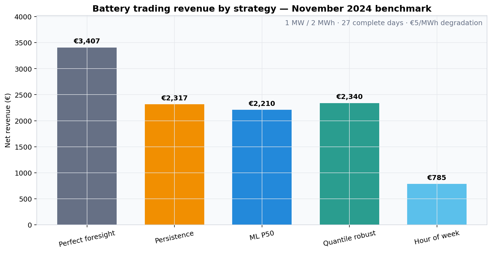
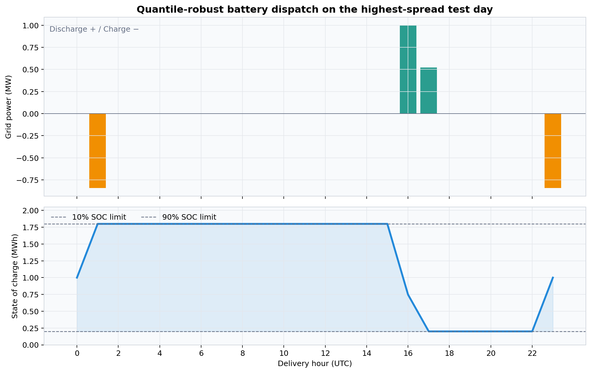

# German Multi-Market BESS Trading & Risk Engine

A reproducible applied research repository for studying how day-ahead price forecast
quality and uncertainty affect a simulated German battery's dispatch, revenue, and
risk. It combines real ENTSO-E prices, rolling probabilistic forecasting, constrained
optimization, realized-price settlement, and an interactive dashboard. It does not
claim live trading performance or fabricate balancing-market data.




## Problem and research questions

Battery value depends less on predicting every price precisely than on identifying the
right spreads under physical constraints. This project asks whether lower MAE actually
means higher revenue, which mistakes are economically costly, whether calibrated
quantiles improve risk-adjusted returns, how large realistic regret is, and how results
change with duration, efficiency, and degradation assumptions.

## German market context

The German/Luxembourg day-ahead market clears delivery intervals ahead of operation;
high variable renewable output can compress or invert prices, while scarcity and
forecast errors create volatile spreads. A battery can shift energy but loses energy
and incurs wear. Reserve participation can add value but has different availability,
activation, and settlement rules, so it cannot be inferred from day-ahead prices.

## Data

The credential-safe ENTSO-E client downloads day-ahead prices, actual load, and
generation. Raw and processed stores are separate and ignored by Git. Validation checks
UTC, duplicates, gaps, irregular frequency, schema, infinities, and impossible physical
values. See [DATA_DICTIONARY.md](DATA_DICTIONARY.md). ENTSO-E access requires a free
Transparency Platform API token.

```powershell
Copy-Item .env.example .env
# Load ENTSOE_API_TOKEN into your shell using your preferred secret manager.
python -m pip install -e ".[dev,dashboard,models]"
bess-research fetch-prices --start 2024-01-01 --end 2025-01-01
```

The CLI reads `ENTSOE_API_TOKEN` from the environment; it does not automatically parse
`.env`, reducing accidental secret persistence. API errors never log the request URL.

## Forecasting methodology

Baselines are previous-day persistence and expanding historical hour-of-week means. A
portable quantile gradient-boosting model produces P10/P50/P90; optional LightGBM and
XGBoost dependencies are reserved for experiment adapters. Evaluation uses rolling
temporal windows only. Price lags and rolling values are conservative and fundamentals
must be archived day-ahead forecasts. See [ASSUMPTIONS.md](ASSUMPTIONS.md).

The published benchmark refits the quantile GBM every seven days using a trailing
365-day window. The model uses local calendar encodings, 24/48/168-hour price lags,
and causal rolling price statistics. It does not use realized load, renewable
generation, or any future price.


The P50 gradient-boosting model improves both MAE and RMSE over the simple baselines,
but forecast accuracy alone does not determine battery revenue.

## Battery model and optimization

The default simulated battery is 1 MW / 2 MWh with 10–90% SOC, 95% one-way efficiency,
a linear degradation cost, and a daily equivalent-cycle constraint. CVXPY maximizes
forecast margin net of degradation while enforcing energy, power, SOC, cycle, and
terminal-SOC constraints. The robust policy penalizes charging with upper-tail prices
and discharging with lower-tail prices. Perfect foresight uses the same optimizer and
is only an unattainable upper bound.

## Published benchmark results

Schedules are settled against realized prices, never forecasts. Metrics include gross
and net revenue, throughput, cycles, degradation, drawdown, volatility, and tail loss.

The first checked-in benchmark uses 27 complete UTC delivery days from 1–30 November
2024. Models are trained on trailing ENTSO-E DE-LU prices; days with incomplete
realized prices are excluded from dispatch and settlement. Values below are simulated
for the default 1 MW / 2 MWh battery and include €5/MWh throughput degradation.

| Forecast | MAE (€/MWh) | RMSE (€/MWh) |
|---|---:|---:|
| Persistence | 34.71 | 56.26 |
| Historical hour-of-week | 40.34 | 67.29 |
| Quantile GBM P50 | **29.06** | **55.61** |

The P10–P90 interval covered 53.4% of realized prices with a mean width of
€54.86/MWh. This is below the nominal 80% target, so the quantiles are not presented as
well calibrated.


The highest-spread test day illustrates an economically important failure mode: the
model recognized an afternoon price increase, but materially underestimated its size
and the realized price moved outside P90.

| Strategy | Net revenue (€) | Throughput (MWh) | Max drawdown (€) | Tail loss / CVaR (€) | Regret (€) |
|---|---:|---:|---:|---:|---:|
| Perfect foresight upper bound | 3,407 | 128.31 | -239.69 | 98.31 | 0 |
| Persistence dispatch | 2,317 | 131.79 | -245.01 | 106.51 | 1,091 |
| Historical hour-of-week | 785 | 152.45 | -288.90 | 115.03 | 2,622 |
| ML P50 dispatch | 2,210 | 120.62 | -218.97 | 104.80 | 1,198 |
| Quantile-robust dispatch | **2,340** | **88.91** | **-205.71** | **94.21** | **1,067** |

The results demonstrate why MAE is not a trading objective: ML P50 had the lowest MAE
but earned less than persistence. The robust policy earned 5.9% more than ML P50 while
using 26.3% less throughput and reducing the reported tail loss by 10.1%. The weekly
MAE–revenue Spearman estimate was 0.60, but with only five weeks (`p=0.285`) it is not
statistically conclusive. These are descriptive findings for one short historical
window, not expected annual returns.


The robust policy occupies the preferred upper-left region: higher revenue and lower
tail loss than the other implementable strategies. Bubble size represents throughput,
which also makes the reduction in battery use visible.


### Battery operation

The optimizer respects grid-side power, SOC, efficiency, cycling, and terminal-energy
constraints. On the highest-spread test day it charges before the expected peak,
discharges into the peak, and restores terminal SOC near the end of the horizon.



Machine-readable forecasts, dispatch, metrics, input hashes, and a full discussion are
in [`results/energy_benchmark_2024`](results/energy_benchmark_2024). The experiment
design and future regime analyses are specified in
[docs/EXPERIMENT_DESIGN.md](docs/EXPERIMENT_DESIGN.md).

## Limitations

This is a historical simulation of a price-taking battery, not commercial trading. It
omits bid acceptance, fees, imbalance, network charges, taxes, intraday updates, and
detailed cell aging. Multi-market logic is intentionally pending real
regelleistung.net capacity and activation data plus product rules. Actual load and
generation are not valid forecast-time features.

## Architecture

Source code lives in `src/bess_trading`; configuration, tests, documentation, dashboard,
and immutable/processed data layers are separate. The full dataflow and artifact
contract are in [docs/ARCHITECTURE.md](docs/ARCHITECTURE.md).

## Reproduce

```bash
python -m pip install -e ".[dev,dashboard,visualization]"
pytest
ruff check .
python experiments/run_energy_benchmark.py data/raw/entsoe_prices_2023.parquet data/raw/entsoe_prices_2024.parquet
python experiments/create_readme_figures.py
streamlit run dashboard/app.py
```

Docker builds the dashboard without embedding credentials. Mount data read-only or use
the CLI outside the container to create experiment artifacts.

## Future work

Add versioned ENTSO-E forecast ingestion, a causal experiment runner, LightGBM/XGBoost
adapters, real reserve-market loaders and co-optimization, nested hyperparameter
selection, block bootstrap inference, richer aging, intraday recourse, and market-rule
aware bid construction.
