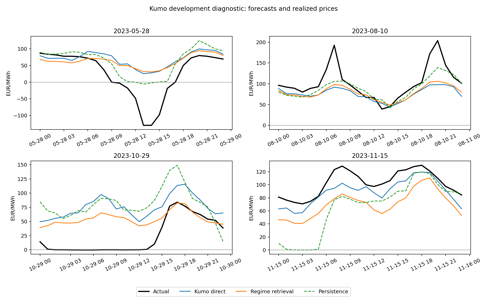

# NVIDIA Kumo Forecast and domain-aware retrieval: research extension

## Executive conclusion

This branch integrates NVIDIA Kumo Forecast into the existing causal German day-ahead
battery experiment without changing the battery model, settlement accounting, or frozen
Phase 1/2 evidence. Official Kumo direct inference works on the available CPU environment.
The first four-day, pre-test diagnostic provides **directional but insufficient** evidence that
an external electricity-regime retrieval blend may improve both price forecasts and dispatch
value. It does not establish statistical or trading superiority.

The central research question therefore remains open. Native DARR has been integrated and
causality-tested through the official API, but an official-checkpoint DARR benchmark has not
been launched because archive embedding is computationally expensive on this CPU-only setup.
The scientific gate correctly stops the full study until at least 20 development days are
available and the native-DARR compute budget is justified.




## Scope and evidence status

The study extends Phase 2: hourly Germany/Luxembourg day-ahead energy-only trading. It does
not attribute intraday or reserve revenue to Kumo. The existing 2024 findings are visible, so
any later 2024 evaluation must be called a retrospective replication rather than an untouched
test. All configuration choices in this branch are made from dates before 2024.

The existing published Phase 2 results remain unchanged: Quantile GBM test MAE 23.02
EUR/MWh, regularized-linear test MAE 23.91 EUR/MWh, conformal P10-P90 coverage 80.43%, and
approximately EUR 3.66/day lower revenue for the tested stochastic-CVaR policy than for
deterministic P50 dispatch. These are historical project findings, not universal conclusions.

## Official NVIDIA implementation audit

The audited source is [NVIDIA/Kumo-TS](https://github.com/NVIDIA/Kumo-TS) commit
`ad459475d1302fc8365e7117e39837a8ecb6a7e3`, inspected on 2026-11-14.

| Item | Verified implementation |
|---|---|
| Package | `kumo-forecast==1.0.1` |
| License | Apache-2.0 for NVIDIA-authored code, subject to third-party notices |
| Public API | `sdk.forecasting.ForecastingConfig`, `perform_forecasting` |
| Checkpoint repository | `nvidia/Kumo-Forecast` |
| Selected checkpoint | `run8_best_model_cr.pt` (1.42 GB downloaded artifact) |
| Backbone | `AutonLab/MOMENT-1-large` |
| Context | 512 observations in this experiment |
| Requested-horizon limit | 512 observations; longer-than-head requests use rollout |
| Native DARR | cosine-neighbor historical continuation and weighted blending |
| DARR controls | `alpha`, `k`, `temperature`, `context_stride` |
| Probabilistic output | no verified calibrated P10/P50/P90 interface |
| Future exogenous inputs | numeric channels are not a verified future-covariate interface |
| Public retrieval diagnostics | forecast is returned; neighbor identities are not exposed |

Native DARR is not described as electricity-domain-aware. The regime filter, causal archive,
neighbor audit trail, residual calibration, and battery optimizer are project-owned external
components. Kumo is treated as a point forecaster.

Standard Kumo inference fills numeric missing values with zero. The separate missingness-aware
path cannot be combined with DARR in the audited SDK. This integration consequently rejects
silent zero filling and uses the newest complete hourly context. That conservative policy
exposed material isolated gaps in the local ENTSO-E extracts: some dates cannot supply a recent
512-hour context while remaining within Kumo's 512-step forecast limit. Such dates are excluded
from the small diagnostic rather than silently imputed. A full study must pre-register and test
a causal imputation policy or obtain corrected source vintages.

## Temporal contract

For delivery day D, a forecast is issued at 11:00 Europe/Berlin on D-1. Each input price must
have a repository publication timestamp no later than that issue time. The adapter predicts
the entire path from the final admissible observation through delivery-day end, then selects
the physical UTC timestamps belonging to D. This supports 23-, 24-, and 25-hour local days.

Native-DARR context is cut at the same information vintage. The external archive admits a
candidate only when its input window and entire continuation were published by the current
issue time. Forecast-time regimes use only prior published prices and optionally archived
fundamental forecasts with explicit availability timestamps. Realized regimes are evaluation
labels only.

Automated tests deliberately modify future prices and future fundamentals. Forecast inputs,
cache keys, archive candidates, and regime assignments must remain invariant or reject the
injection.

## Components implemented

- `adapter.py`: optional official backend, issue-time alignment, DST extraction, version and
  hardware metadata, experiment-hash cache, and native-DARR invocation.
- `retrieval.py`: auditable project-owned historical-continuation retrieval with regime filters,
  similarity weights, level adjustment, causal continuation availability, and fallback.
- `regimes.py`: development-only thresholds and forecast-time labels for negative-price risk,
  volatility, renewable surplus, scarcity, calendar, and seasonal conditions.
- `calibration.py`: empirical residual intervals, split-conformal correction, regime fallback,
  and coherent residual-block scenarios fitted before the test cutoff.
- `diagnostics.py`: price error, event detection, daily rank correlation, charge/discharge-hour
  overlap, extreme timing, spread error, and decision-influence diagnostics.
- `kumo_decision_value.py`: deterministic, calibrated robust, and scenario-CVaR adapters using
  the existing optimization engines, independent continuous SOC per strategy, and independent
  battery-simulator feasibility verification.
- `kumo_benchmark.py`: small chronological diagnostic, compute logging, paired revenue
  comparison, and a minimum-sample feasibility gate.

No checkpoint is committed. The pinned optional dependency references the audited official
Git revision.

## Battery and economic invariants

All methods use the same 1 MW / 2 MWh battery, 10%-90% SOC, initial 50% SOC, 95% charge and
discharge efficiencies, EUR 5/MWh throughput degradation, 1.5 equivalent cycles/day, and
HiGHS solver. Charge/discharge exclusivity, shared inverter capacity, SOC transitions,
continuous strategy-specific SOC, terminal semantics, and independent feasibility checks are
unchanged. Forecast schedules are settled against the same realized prices. Perfect foresight
is included only as a labelled upper bound.

## Preliminary development diagnostic

Four dates were selected before 2024 and before test evaluation: 2023-05-28, 2023-08-10,
2023-10-29, and 2023-11-15. They cover negative prices, a high-spread/scarcity-like day, the
autumn DST transition, and a lower-volatility day. This is a diagnostic sample, not a benchmark.

| Forecast | MAE (EUR/MWh) | RMSE (EUR/MWh) | Mean rank correlation |
|---|---:|---:|---:|
| Persistence | 38.06 | 48.72 | 0.734 |
| Hour of week | 45.94 | 58.34 | 0.659 |
| Kumo direct | 35.11 | 48.30 | 0.692 |
| Kumo + external regime retrieval | 34.16 | 45.38 | 0.687 |

The blend improves MAE by 0.95 EUR/MWh and RMSE by 2.91 EUR/MWh relative to Kumo direct,
while slightly reducing average rank correlation. Neither Kumo method detects negative-price
hours in this tiny sample, and the blend increases mean spread absolute error from 69.01 to
77.96 EUR/MWh. These mixed results matter because battery value depends more on rankings and
spreads than on level error alone.

| Dispatch strategy | Net revenue (EUR) | Throughput (MWh) | EFC | Revenue/EFC (EUR) |
|---|---:|---:|---:|---:|
| Persistence | 781.62 | 18.17 | 4.54 | 172.08 |
| Hour of week | 675.13 | 19.17 | 4.79 | 140.88 |
| Kumo direct | 746.00 | 21.99 | 5.50 | 135.73 |
| Kumo + external regime retrieval | 788.09 | 21.96 | 5.49 | 143.52 |
| Perfect foresight upper bound | 906.82 | 19.58 | 4.89 | 185.28 |

The external blend earns EUR 42.09 more than Kumo direct over these four days with similar
throughput. Persistence still earns EUR 35.62 more than Kumo direct and has substantially
higher revenue per cycle. This prevents a claim that Kumo is already superior.

Although the four-day paired bootstrap happens to give a positive interval for the regime
blend, inference from four selected days is not defensible. The gate requires at least 20
development days; its current decision is `insufficient_evidence`. No 2024 results were used.

## Compute and feasibility

The host reports a GTX 1650 with 4 GB VRAM, but the installed compatible PyTorch build is CPU
only (`torch 2.15.0+cpu`, CUDA unavailable). Cold start, including official downloads and model
loading, took 261.6 seconds. After model caching, measured per-origin direct inference was about
0.31-0.32 seconds; one process-start measurement was 20.19 seconds. External retrieval currently
takes tens of seconds per origin because it constructs an auditable chronological archive in
Python; this is a clear optimization target.

Native DARR embeds a historical archive for each causal information vintage and does not expose
neighbor identities through the public result. Given CPU-only execution and the prior warning
that DARR may be costly, a broad parameter grid was not run. This is a resource-aware negative
status, not evidence that DARR fails.

## Probabilistic and stochastic status

The calibration and coherent-scenario adapters are implemented and tested, but four origins
are insufficient to estimate stable regime-conditioned residual distributions. Consequently,
this branch does not publish Kumo P10/P50/P90 coverage, WIS/CRPS, PIT diagnostics, or Kumo CVaR
revenue. Doing so would fabricate precision. After a larger development run, calibration must
use only earlier residuals, sparse regimes must fall back to global residuals, and configuration
must be frozen before the retrospective 2024 replication.

## Reproduction

Create the project environment, then install the optional pinned Kumo dependency:

```bash
pip install -e ".[dev,models,visualization,kumo]"
```

Run leakage/physics tests and the small diagnostic:

```bash
pytest tests/test_kumo_forecasting.py tests/test_kumo_retrieval.py \
  tests/test_kumo_causality.py tests/test_kumo_dispatch.py -q
bess-research run-kumo-diagnostic --config configs/kumo_research.yaml
python scripts/plot_kumo_diagnostic.py
```

Outputs are isolated under `results/kumo_development_diagnostic/` and cache entries under
`artifacts/kumo_cache/`. The frozen Phase 1/2 artifacts are not modified.

## Direct answers to the research questions

- **RQ1:** unresolved. Kumo direct beats the two simple baselines on MAE across four selected
  dates but not persistence on realized revenue. Existing learned Phase 2 models have not yet
  been rerun on a sufficiently large identical-date development set.
- **RQ2:** unresolved. Official native DARR is integrated but not empirically executed through
  the development gate on the CPU-only host.
- **RQ3:** promising but unproven. External regime retrieval improves level error and net
  revenue versus direct Kumo in four dates, while worsening rank and spread metrics.
- **RQ4:** unsupported. Negative-price recall is zero and the event sample is too small.
- **RQ5:** unsupported as a general conclusion. The four-day blend earns more than direct Kumo,
  but persistence earns more than direct Kumo and sample uncertainty dominates.
- **RQ6:** unresolved. Coherent scenario infrastructure exists; adequate leakage-safe Kumo
  residual history does not yet exist.
- **RQ7:** unresolved. Direct cached inference is practical on CPU; auditable retrieval is much
  slower and has not yet demonstrated benefit sufficient to justify a full DARR grid.

## Recommended next action

Repair or pre-register causal treatment of isolated source gaps, then run 20-30 chronologically
spaced 2023 development origins with frozen direct and external-retrieval settings. Profile one
official native-DARR origin with a capped archive and record RAM/time before authorizing more.
Only if economic ranking and revenue evidence survives that gate should the project fit Kumo
residual calibration, freeze all settings, and perform the retrospective 2024 decision-value
comparison. A newer authoritative year should be reserved for a genuinely prospective shadow
evaluation.
