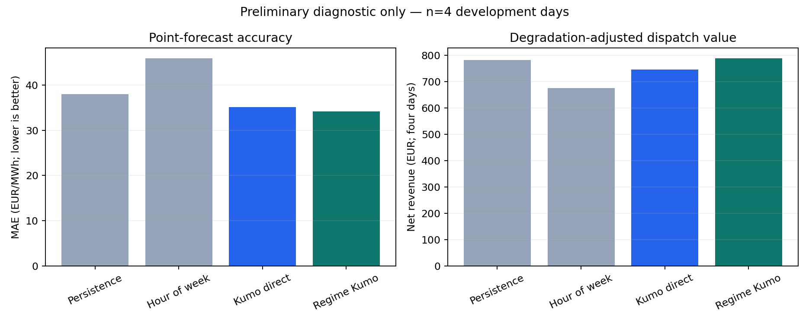
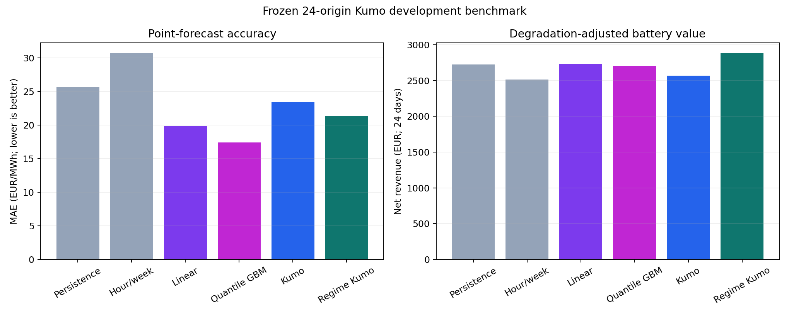
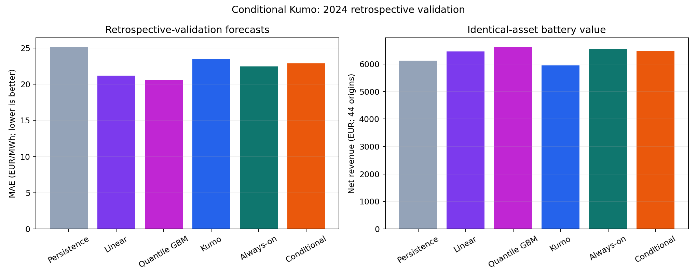
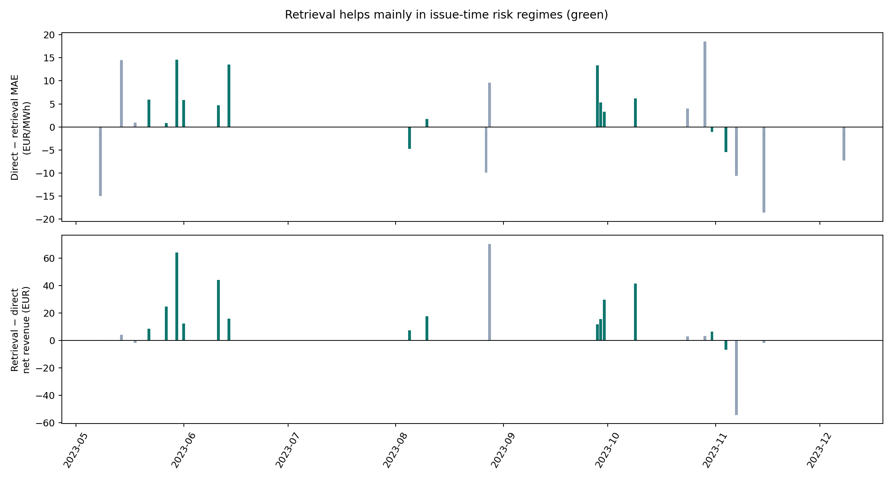
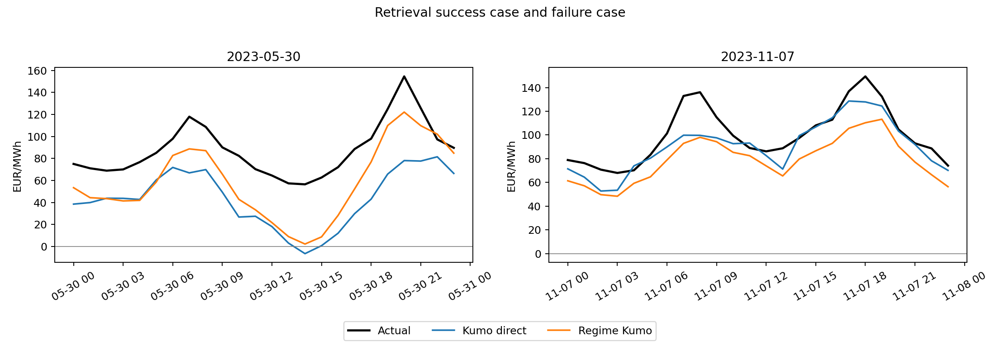
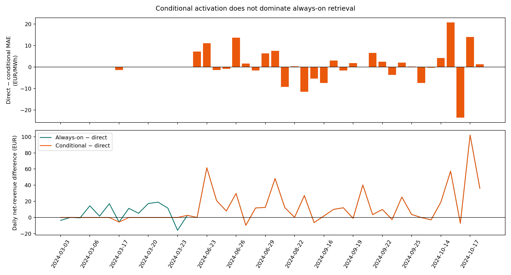
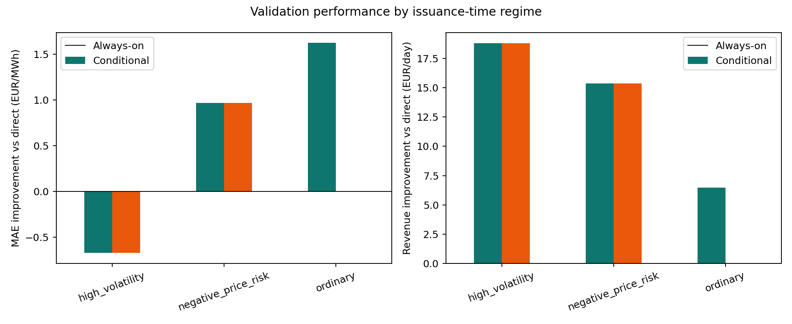

# NVIDIA Kumo Forecast and domain-aware retrieval: research extension

## Executive conclusion

This branch integrates NVIDIA Kumo Forecast into the existing causal German day-ahead battery
experiment without changing the battery model, settlement accounting, or frozen Phase 1/2
evidence. The latest study pre-registers a conditional policy in commit `36b3e3f`, then evaluates
69 eligible 2023 policy-development origins and 44 subsequent 2024 retrospective-validation
origins. Every Kumo prediction comes from the official checkpoint.

The fixed conditional policy activates retrieval under forecast-time high-volatility or
negative-price-risk labels. On retrospective validation it improves net revenue over Kumo Direct
by EUR 11.84/day (95% block-bootstrap interval EUR 5.45 to EUR 18.27), but it is worse than
always-on retrieval by EUR 1.77/day (interval -EUR 4.68 to EUR 0.25). Conditional MAE is 22.87
EUR/MWh versus 22.43 for always-on retrieval, 23.49 for direct Kumo, 21.16 for linear, and 20.55
for Quantile GBM. The rule therefore fails its pre-registered requirement to beat both direct and
always-on retrieval.

The evidence supports retrieval as an economically useful addition to direct Kumo on this
retrospective panel, but not the proposed conditional gate and not incremental superiority over
conventional ML. **Retain the conventional models as the production research reference. Do not
proceed to forecasting-head fine-tuning or native DARR from these results.** Native DARR and
fine-tuning remain unevaluated.








## Scope and evidence status

The study extends Phase 2: hourly Germany/Luxembourg day-ahead energy-only trading. It does
not attribute intraday or reserve revenue to Kumo. The existing 2024 findings are visible, so
any later 2024 evaluation must be called a retrospective replication rather than an untouched
test. All configuration choices in this branch are made from dates before 2024.

The existing published Phase 2 results remain unchanged: Quantile GBM test MAE 23.02
EUR/MWh, regularized-linear test MAE 23.91 EUR/MWh, conformal P10-P90 coverage 80.43%, and
approximately EUR 3.66/day lower revenue for the tested stochastic-CVaR policy than for
deterministic P50 dispatch. These are historical project findings, not universal conclusions.

## Official NVIDIA implementation audit

The audited source is [NVIDIA/Kumo-TS](https://github.com/NVIDIA/Kumo-TS) commit
`ad459475d1302fc8365e7117e39837a8ecb6a7e3`, inspected on 2026-11-14.

| Item | Verified implementation |
|---|---|
| Package | `kumo-forecast==1.0.1` |
| License | Apache-2.0 for NVIDIA-authored code, subject to third-party notices |
| Public API | `sdk.forecasting.ForecastingConfig`, `perform_forecasting` |
| Checkpoint repository | `nvidia/Kumo-Forecast` |
| Selected checkpoint | `run8_best_model_cr.pt` (1.42 GB downloaded artifact) |
| Backbone | `AutonLab/MOMENT-1-large` |
| Context | 512 observations in this experiment |
| Requested-horizon limit | 512 observations; longer-than-head requests use rollout |
| Native DARR | cosine-neighbor historical continuation and weighted blending |
| DARR controls | `alpha`, `k`, `temperature`, `context_stride` |
| Probabilistic output | no verified calibrated P10/P50/P90 interface |
| Future exogenous inputs | numeric channels are not a verified future-covariate interface |
| Public retrieval diagnostics | forecast is returned; neighbor identities are not exposed |

Native DARR is not described as electricity-domain-aware. The regime filter, causal archive,
neighbor audit trail, residual calibration, and battery optimizer are project-owned external
components. Kumo is treated as a point forecaster.

Standard Kumo inference fills numeric missing values with zero. The separate missingness-aware
path cannot be combined with DARR in the audited SDK. This integration consequently rejects
silent zero filling and uses the newest complete hourly context. That conservative policy
exposed material isolated gaps in the local ENTSO-E extracts: some dates cannot supply a recent
512-hour context while remaining within Kumo's 512-step forecast limit. Such dates are excluded
from the small diagnostic rather than silently imputed. A full study must pre-register and test
a causal imputation policy or obtain corrected source vintages.

## Temporal contract

For delivery day D, a forecast is issued at 11:00 Europe/Berlin on D-1. Each input price must
have a repository publication timestamp no later than that issue time. The adapter predicts
the entire path from the final admissible observation through delivery-day end, then selects
the physical UTC timestamps belonging to D. This supports 23-, 24-, and 25-hour local days.

Native-DARR context is cut at the same information vintage. The external archive admits a
candidate only when its input window and entire continuation were published by the current
issue time. Forecast-time regimes use only prior published prices and optionally archived
fundamental forecasts with explicit availability timestamps. Realized regimes are evaluation
labels only.

Automated tests deliberately modify future prices and future fundamentals. Forecast inputs,
cache keys, archive candidates, and regime assignments must remain invariant or reject the
injection.

## Components implemented

- `adapter.py`: optional official backend, issue-time alignment, DST extraction, version and
  hardware metadata, experiment-hash cache, and native-DARR invocation.
- `retrieval.py`: auditable project-owned historical-continuation retrieval with regime filters,
  similarity weights, level adjustment, causal continuation availability, and fallback.
- `regimes.py`: development-only thresholds and forecast-time labels for negative-price risk,
  volatility, renewable surplus, scarcity, calendar, and seasonal conditions.
- `calibration.py`: empirical residual intervals, split-conformal correction, regime fallback,
  and coherent residual-block scenarios fitted before the test cutoff.
- `diagnostics.py`: price error, event detection, daily rank correlation, charge/discharge-hour
  overlap, extreme timing, spread error, and decision-influence diagnostics.
- `kumo_decision_value.py`: deterministic, calibrated robust, and scenario-CVaR adapters using
  the existing optimization engines, independent continuous SOC per strategy, and independent
  battery-simulator feasibility verification.
- `kumo_benchmark.py`: small chronological diagnostic, compute logging, paired revenue
  comparison, and a minimum-sample feasibility gate.

No checkpoint is committed. The pinned optional dependency references the audited official
Git revision.

## Battery and economic invariants

All methods use the same 1 MW / 2 MWh battery, 10%-90% SOC, initial 50% SOC, 95% charge and
discharge efficiencies, EUR 5/MWh throughput degradation, 1.5 equivalent cycles/day, and
HiGHS solver. Charge/discharge exclusivity, shared inverter capacity, SOC transitions,
continuous strategy-specific SOC, terminal semantics, and independent feasibility checks are
unchanged. Forecast schedules are settled against the same realized prices. Perfect foresight
is included only as a labelled upper bound.

## Preliminary development diagnostic

Four dates were selected before 2024 and before test evaluation: 2023-05-28, 2023-08-10,
2023-10-29, and 2023-11-15. They cover negative prices, a high-spread/scarcity-like day, the
autumn DST transition, and a lower-volatility day. This is a diagnostic sample, not a benchmark.

| Forecast | MAE (EUR/MWh) | RMSE (EUR/MWh) | Mean rank correlation |
|---|---:|---:|---:|
| Persistence | 38.06 | 48.72 | 0.734 |
| Hour of week | 45.94 | 58.34 | 0.659 |
| Kumo direct | 35.11 | 48.30 | 0.692 |
| Kumo + external regime retrieval | 34.16 | 45.38 | 0.687 |

The blend improves MAE by 0.95 EUR/MWh and RMSE by 2.91 EUR/MWh relative to Kumo direct,
while slightly reducing average rank correlation. Neither Kumo method detects negative-price
hours in this tiny sample, and the blend increases mean spread absolute error from 69.01 to
77.96 EUR/MWh. These mixed results matter because battery value depends more on rankings and
spreads than on level error alone.

| Dispatch strategy | Net revenue (EUR) | Throughput (MWh) | EFC | Revenue/EFC (EUR) |
|---|---:|---:|---:|---:|
| Persistence | 781.62 | 18.17 | 4.54 | 172.08 |
| Hour of week | 675.13 | 19.17 | 4.79 | 140.88 |
| Kumo direct | 746.00 | 21.99 | 5.50 | 135.73 |
| Kumo + external regime retrieval | 788.09 | 21.96 | 5.49 | 143.52 |
| Perfect foresight upper bound | 906.82 | 19.58 | 4.89 | 185.28 |

The external blend earns EUR 42.09 more than Kumo direct over these four days with similar
throughput. Persistence still earns EUR 35.62 more than Kumo direct and has substantially
higher revenue per cycle. This prevents a claim that Kumo is already superior.

Although the four-day paired bootstrap happens to give a positive interval for the regime
blend, inference from four selected days is not defensible. The gate requires at least 20
development days; its current decision is `insufficient_evidence`. No 2024 results were used.

## Frozen 24-origin development benchmark

The expanded panel was frozen before new inference in commit `5ca05f0`. It includes dates from
May through December 2023, weekdays and weekends, the 25-hour autumn DST day, and issue-time
ordinary, negative-price-risk and high-volatility strata. The selection manifest is
`configs/kumo_development_origins_v1.csv`; its criteria are documented in
`docs/KUMO_DEVELOPMENT_SELECTION.md`.

Selection used only information available at the 11:00 Europe/Berlin issue time. It did not use
delivery-day price levels, negative-price outcomes, spreads, model errors, or battery revenue.
Of 365 candidate 2023 days, 223 required more than the verified 512 forecast steps from the
latest complete 512-hour context, 66 had a gap in the latest 168-hour retrieval context, and 7
had incomplete settlement curves. Sixty-nine days were eligible and 24 were stratified and
frozen. This strict policy creates calendar-selection bias and leaves only one winter origin.

The regularized-linear and Quantile-GBM comparisons use the unchanged Phase 1 model classes,
365-day causal training windows, seven-day refits, and 100 boosting iterations. They were
recomputed on the selected timestamps because the frozen 2024 artifacts do not contain 2023
predictions; no reference implementation or hyperparameter was changed for Kumo.

### Forecast results

| Forecast | MAE (EUR/MWh) | RMSE (EUR/MWh) | Rank correlation | Bottom-hour overlap | Top-hour overlap |
|---|---:|---:|---:|---:|---:|
| Persistence | 25.61 | 36.89 | 0.763 | 0.615 | 0.615 |
| Hour of week | 30.71 | 39.40 | 0.734 | 0.521 | 0.594 |
| Regularized linear | 19.82 | 25.90 | 0.819 | 0.667 | 0.708 |
| Quantile GBM P50 | **17.40** | **24.80** | 0.799 | 0.594 | 0.667 |
| Kumo Direct | 23.43 | 30.59 | 0.722 | 0.615 | 0.594 |
| Kumo + external regime retrieval | 21.31 | 27.01 | **0.810** | **0.698** | **0.750** |

Retrieval reduces aggregate MAE by 2.11 EUR/MWh and RMSE by 3.58 EUR/MWh relative to direct
Kumo. It also improves price ranking and economically relevant top/bottom-hour selection. Its
mean spread absolute error is slightly worse, however: 36.36 versus 35.42 EUR/MWh.

The panel contains 16 actual negative-price hours across three delivery days. Kumo Direct and
regime Kumo predict none of them, giving zero recall. Quantile GBM negative-price F1 is 0.50,
linear F1 is 0.47, and persistence F1 is 0.17. The pre-2024 99th-percentile spike threshold is
530.49 EUR/MWh, and the selected panel contains no hours above it. All reported spike scores are
therefore uninformative zeros, not evidence of successful spike prediction.

Daily paired MAE improvement averages 2.08 EUR/MWh, but its 95% seven-origin circular
block-bootstrap interval is -2.89 to +6.16 EUR/MWh; paired effect size is 0.21. Because origins
are discontinuous, a block is seven ordered origins rather than seven consecutive calendar
days. The interval crosses zero and the 24 selected days are still a modest, non-random sample.

### Battery decision value

| Strategy | Net revenue (EUR) | Throughput (MWh) | EFC | Degradation (EUR) | Revenue/EFC (EUR) |
|---|---:|---:|---:|---:|---:|
| Persistence | 2,722.64 | 119.02 | 29.75 | 595.08 | 91.51 |
| Hour of week | 2,512.24 | 121.20 | 30.30 | 606.00 | 82.91 |
| Regularized linear | 2,731.95 | 115.11 | 28.78 | 575.57 | **94.93** |
| Quantile GBM P50 | 2,703.88 | 116.80 | 29.20 | 584.01 | 92.60 |
| Kumo Direct | 2,566.17 | 124.76 | 31.19 | 623.79 | 82.28 |
| Kumo + external regime retrieval | **2,882.56** | 126.33 | 31.58 | 631.66 | 91.27 |
| Perfect foresight upper bound | 3,398.67 | 116.34 | 29.08 | 581.69 | 116.85 |

Regime Kumo is the highest-revenue non-perfect strategy on this panel and earns EUR 316.39 more
than Kumo Direct. It also cycles slightly more rather than merely avoiding low-value cycles.
Mean paired revenue improvement is EUR 13.18/day, with a 95% block-bootstrap interval of
-EUR 0.65 to +EUR 24.84/day, effect size 0.53, and bootstrap probability of improvement 96.85%.
Because the interval crosses zero, superiority is not statistically established.

Every strategy maintains an independent SOC state. SOC is carried between selected origins and
held unchanged across non-evaluated calendar gaps. Independent simulation finds zero
simultaneous charge/discharge intervals, no SOC-bound violation, shared-inverter excess below
2e-15 MW, and maximum daily cycling of 1.5000000000000002 EFC against the 1.5-EFC limit (solver
tolerance). This is a selected-origin comparison, not a claim that the asset traded on omitted
calendar days.

Downside is not uniformly better. Both Kumo strategies lose money on one of 24 days. Daily 95%
CVaR loss is -EUR 2.67 for direct Kumo (the empirical tail remains profitable under the sign
convention) versus +EUR 0.65 for regime Kumo, and maximum drawdown worsens from -EUR 22.03 to
-EUR 28.67. The retrieval strategy therefore raises mean return while slightly worsening the
observed downside and degradation bill.

### Where retrieval helps and hurts



| Forecast-time condition | Days | Mean MAE improvement | Mean revenue improvement | MAE wins | Revenue wins |
|---|---:|---:|---:|---:|---:|
| Negative-price risk | 14 | +4.57 EUR/MWh | +EUR 21.01/day | 11/14 | 13/14 |
| High volatility | 6 | +8.11 EUR/MWh | +EUR 29.25/day | 6/6 | 6/6 |
| Ordinary (neither label) | 10 | **-1.40 EUR/MWh** | +EUR 2.23/day | 5/10 | 4/10 |
| Weekend | 8 | +2.71 EUR/MWh | +EUR 13.36/day | 5/8 | 6/8 |
| Weekday | 16 | +1.77 EUR/MWh | +EUR 13.10/day | 11/16 | 11/16 |

Benefits concentrate in regimes identified before delivery. All six high-volatility origins
improve on both MAE and revenue. Conversely, retrieval worsens mean MAE in ordinary contexts
and improves revenue on only four of ten such days. The worst revenue failure is 2023-11-07
(-EUR 54.45 versus direct Kumo, with MAE worse by 10.60 EUR/MWh). The largest MAE failure is
2023-11-15 (-18.65 EUR/MWh). Strong successes include 2023-05-30 (+EUR 64.22 and +14.61
EUR/MWh MAE improvement) and 2023-08-28 (+EUR 70.41).



## Conditional retrieval study: 113 chronological origins

The 24-origin result was treated as hypothesis-generating. Commit `36b3e3f` freezes the next
experiment before new 2024 Kumo outcomes: all 69 strictly eligible 2023 origins form the
policy-development sample, while all 44 subsequent eligible 2024 origins form a retrospective
validation sample. The 2024 period is chronological but not genuinely untouched because the
repository's conventional-model results were already public.

The policy activates the same 50/50 regime-retrieval blend when the last 168 published prices
trigger `high_volatility` (hourly-change volatility >= EUR 20/MWh) or `negative_price_risk`
(negative-price share >= 2%). It otherwise uses Kumo Direct. Thresholds, neighbor settings,
fallback, dates, block lengths, and decision criteria were not changed after validation.

### Optimized retrieval correctness and runtime

The optimized implementation builds a versioned archive of candidate contexts, continuations,
publication cutoffs, availability times and regime labels. Per-origin eligibility is filtered
against the forecast issue time before vectorized cosine similarity. Cache keys contain the full
data-vintage fingerprint, configuration, query origin, query cutoff and hash of eligible
candidates.

On three fixed real origins, optimized and reference implementations select identical neighbors,
weights and regime-filter decisions. Maximum forecast difference is 1.01e-13 EUR/MWh and maximum
weight difference is 5.55e-16. Future-price injection leaves forecasts unchanged.

| Retrieval measurement | Result |
|---|---:|
| Cold archive build | 1.53 s |
| Warm archive load | 0.063 s |
| Optimized mean per origin, 113-origin run | 0.030 s |
| Original fixed-origin range | 27.98-42.97 s |
| Measured fixed-origin speedup | 1,150x-1,663x |
| All 113 optimized searches | 3.42 s |
| Conditional operational searches | 2.00 s |

Direct Kumo takes 103.43 seconds across 113 origins on CPU; the unchanged rolling baselines take
140.77 seconds. Retrieval is no longer the compute bottleneck. On validation, the gate activates
32 of 44 origins (72.7%). Its 1.07 seconds of activated search cost corresponds to about 0.063
seconds per correctly activated MAE improvement and 0.046 seconds per correctly activated
revenue improvement. These ratios describe historical associations, not causal value.

### Policy-development evidence: 2023

| Method | MAE (EUR/MWh) | RMSE (EUR/MWh) | Net revenue (EUR) | Revenue/day (EUR) |
|---|---:|---:|---:|---:|
| Kumo Direct | 22.28 | 29.66 | 7,120.39 | 103.19 |
| Always-on retrieval | 21.39 | 28.54 | **7,770.52** | **112.62** |
| Conditional retrieval | **21.28** | 28.75 | 7,599.37 | 110.14 |
| Regularized linear | 23.44 | 31.06 | 7,434.65 | 107.75 |
| Quantile GBM | 22.57 | 31.97 | 6,990.58 | 101.31 |
| Persistence | 25.19 | 36.13 | 6,929.22 | 100.42 |

The conditional rule activates on 33 of 69 origins (47.8%). It improves development MAE slightly
more than always-on retrieval by avoiding retrieval on ordinary dates, but always-on retrieval
still earns EUR 171.16 more. This was exploratory policy-development evidence only.

### Retrospective-validation forecast evidence: 2024


| Method | MAE (EUR/MWh) | RMSE (EUR/MWh) | Rank correlation | Negative-price F1 |
|---|---:|---:|---:|---:|
| Quantile GBM | **20.55** | **28.98** | **0.851** | **0.283** |
| Regularized linear | 21.16 | 29.31 | 0.833 | 0.098 |
| Always-on retrieval | 22.43 | 30.62 | 0.832 | 0.074 |
| Conditional retrieval | 22.87 | 31.14 | 0.838 | 0.074 |
| Kumo Direct | 23.49 | 32.43 | 0.782 | 0.098 |
| Persistence | 25.14 | 37.75 | 0.763 | 0.423 |

Conditional retrieval improves mean MAE over direct Kumo by 0.62 EUR/MWh, but the primary
seven-origin 95% block-bootstrap interval crosses zero (-1.08 to +2.17). Always-on retrieval
improves by 1.06 EUR/MWh and is 0.44 EUR/MWh better than the conditional policy; that paired
interval also crosses zero. Quantile GBM remains the strongest forecast.

The validation sample contains 68 negative-price hours. Kumo Direct recall is 5.3%, while both
retrieval variants achieve only 4.0%; persistence reaches 40.0%. No eligible validation hour
exceeds the pre-period 99th-percentile spike threshold, so spike metrics are again unsupported.
Point forecasts have 100% availability on all mechanically eligible timestamps. Probabilistic
interval coverage is not applicable because Kumo is evaluated here as a point forecaster.

### Retrospective-validation battery evidence

| Strategy | Net revenue (EUR) | EUR/day | Throughput (MWh) | EFC | Degradation (EUR) | EUR/EFC |
|---|---:|---:|---:|---:|---:|---:|
| Quantile GBM | **6,621.64** | **150.49** | 241.32 | 60.33 | 1,206.59 | 109.76 |
| Always-on retrieval | 6,550.06 | 148.87 | 243.95 | 60.99 | 1,219.75 | 107.40 |
| Conditional retrieval | 6,472.21 | 147.10 | 234.70 | 58.68 | 1,173.51 | **110.31** |
| Regularized linear | 6,460.98 | 146.84 | 238.73 | 59.68 | 1,193.64 | 108.26 |
| Persistence | 6,122.21 | 139.14 | 233.82 | 58.46 | 1,169.12 | 104.73 |
| Kumo Direct | 5,951.44 | 135.26 | 225.10 | 56.27 | 1,125.50 | 105.76 |

Conditional retrieval beats direct Kumo by EUR 11.84/day. Its primary 95% interval is EUR 5.45
to EUR 18.27/day, with paired effect size 0.54; three- and fourteen-origin sensitivity intervals
also remain positive. This is the strongest confirmed economic finding of the Kumo extension.

Conditional retrieval does not beat always-on retrieval: mean difference is -EUR 1.77/day,
95% interval -EUR 4.68 to +EUR 0.25. It is statistically indistinguishable from linear
(+EUR 0.26/day, interval -EUR 9.24 to +EUR 10.22) and trails Quantile GBM by EUR 3.40/day
(interval -EUR 11.15 to +EUR 3.35). Conditional retrieval cycles less than always-on retrieval
and has slightly higher revenue per EFC, but does not maximize total value.

All strategies have zero loss days in the selected validation sample, so empirical maximum
drawdown is zero and downside-tail comparisons are weak. Physical verification finds zero
simultaneous cycling, no SOC violation, shared-inverter excess below 1.4e-15 MW, and maximum
daily cycling exactly at the 1.5-EFC limit. Separate SOC states remain continuous across
consecutive eligible days and are held constant across excluded gaps.

### Regime and activation analysis





| Validation condition | Origins | Always-on MAE gain | Conditional MAE gain | Always-on revenue gain | Conditional revenue gain |
|---|---:|---:|---:|---:|---:|
| High volatility | 18 | -0.68 | -0.68 | +EUR 18.77 | +EUR 18.77 |
| Negative-price risk | 30 | +0.97 | +0.97 | +EUR 15.35 | +EUR 15.35 |
| Overlapping labels | 16 | -0.65 | -0.65 | +EUR 17.34 | +EUR 17.34 |
| Ordinary | 12 | +1.62 | 0.00 | +EUR 6.49 | 0.00 |

The development hypothesis does not transport cleanly. In validation, retrieval increases
revenue during high-volatility conditions despite worsening MAE, illustrating that dispatch
value depends on rankings and spreads rather than level error alone. More importantly, always-on
retrieval also improves both MAE and revenue on ordinary origins. The conditional policy thus
misses six useful MAE retrievals and nine useful revenue retrievals. It has 15 MAE false-positive
activations and nine revenue false-positive activations. These are predictive associations, not
evidence that the regime labels cause retrieval value.

### Pre-registered decision

The policy required a positive primary revenue interval versus both direct and always-on Kumo.
It passes versus direct and fails versus always-on. The conditional hypothesis is therefore not
supported. The result does not support fine-tuning or native DARR, and neither was run.

## Compute and feasibility

The host reports a GTX 1650 with 4 GB VRAM, but the installed compatible PyTorch build is CPU
only (`torch 2.15.0+cpu`, CUDA unavailable). It has 15.71 GB system RAM. The expanded process
used approximately 2.06 GB resident memory at completion.

The original 24-origin implementation records 35.48 seconds of Kumo Direct time and 950.59
seconds of external retrieval. After archive/vectorization work, the 113-origin study records
103.43 seconds of direct Kumo time and only 3.42 seconds of retrieval, plus 0.063 seconds for a
warm archive load. The unchanged rolling linear and Quantile-GBM baseline run takes 140.77
seconds. Retrieval is no longer the dominant cost.

Native DARR embeds a historical archive for each causal information vintage and does not expose
neighbor identities through the public result. Given CPU-only execution and the prior warning
that DARR may be costly, a broad parameter grid was not run. This is a resource-aware negative
status, not evidence that DARR fails.

## Probabilistic and stochastic status

The calibration and coherent-scenario adapters are implemented and tested, but the 113 eligible
origins remain discontinuous because missing-data rules exclude long calendar stretches; they
are not an appropriate dense residual-calibration stream.
Consequently, this branch does not publish Kumo P10/P50/P90 coverage, WIS/CRPS, PIT diagnostics,
or Kumo CVaR revenue. Calibration requires a denser chronological development sequence, using
only earlier residuals and global fallback for sparse regimes, followed by another configuration
freeze before any retrospective 2024 replication.

## Reproduction

Create the project environment, then install the optional pinned Kumo dependency:

```bash
pip install -e ".[dev,models,visualization,kumo]"
```

Run leakage/physics tests and the small diagnostic:

```bash
pytest tests/test_kumo_forecasting.py tests/test_kumo_retrieval.py \
  tests/test_kumo_causality.py tests/test_kumo_dispatch.py -q
bess-research run-kumo-diagnostic --config configs/kumo_research.yaml
python scripts/plot_kumo_diagnostic.py
bess-research run-kumo-expanded --config configs/kumo_development_24.yaml
python scripts/plot_kumo_expanded.py
bess-research run-kumo-conditional --config configs/kumo_conditional_research.yaml
python scripts/plot_kumo_conditional.py
```

Conditional-study outputs are isolated under `results/kumo_conditional_113/`; model and
retrieval caches are under `artifacts/kumo_cache/` and `artifacts/kumo_retrieval_cache/`. The
frozen Phase 1/2 and earlier Kumo artifacts are not modified.

## Direct answers to the research questions

- **RQ1:** Kumo Direct beats persistence but is worse than regularized linear and Quantile GBM
  on retrospective-validation MAE and revenue. Direct Kumo superiority is not supported.
- **RQ2:** unresolved. Official native DARR is integrated but not empirically executed through
  the development gate on the CPU-only host.
- **RQ3:** always-on external retrieval has confirmed retrospective economic value versus direct
  Kumo: +EUR 13.61/day, with a positive 95% interval. Its MAE interval still crosses zero.
- **RQ4:** the fixed regime gate does not generalize. High-volatility retrieval improves revenue
  while worsening MAE, and ordinary origins also benefit from always-on retrieval. Negative-price
  detection remains weak and no qualifying spike occurs.
- **RQ5:** conditional retrieval has confirmed revenue improvement versus direct Kumo but not
  versus always-on retrieval or conventional models. It reduces cycling relative to always-on
  retrieval but sacrifices total revenue.
- **RQ6:** unresolved. Coherent scenario infrastructure exists; adequate leakage-safe Kumo
  residual history does not yet exist.
- **RQ7:** direct cached inference and optimized retrieval are practical on CPU. Retrieval now
  averages 0.030 seconds/origin, but computational feasibility does not change the negative
  policy decision or justify native DARR/fine-tuning.

## Recommended next action

Recommendation **D: retain the conventional ML forecasting models** as the primary reference.
Quantile GBM has the lowest validation MAE and highest validation revenue. Recommendation **A**
is appropriate only as secondary research: continue investigating retrieval-value classifiers
or decision-aware gates using a newly pre-registered dataset, because the simple volatility/negative
rule failed. Do not move to **B**, forecasting-head fine-tuning, or **C**, native DARR, from this
evidence. A newer authoritative year should be reserved for prospective shadow evaluation rather
than additional selection on the already visible 2024 period.
